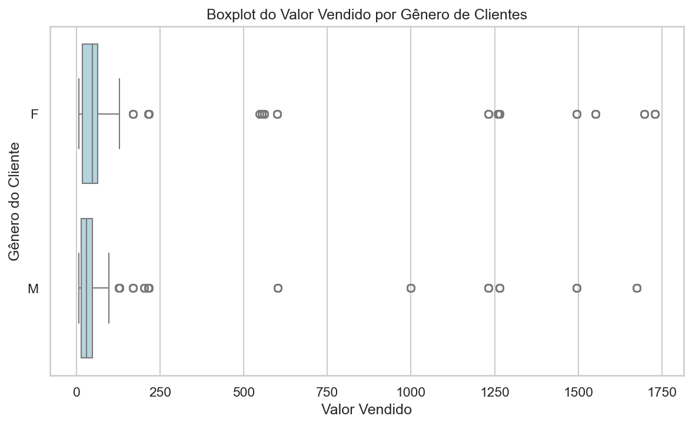
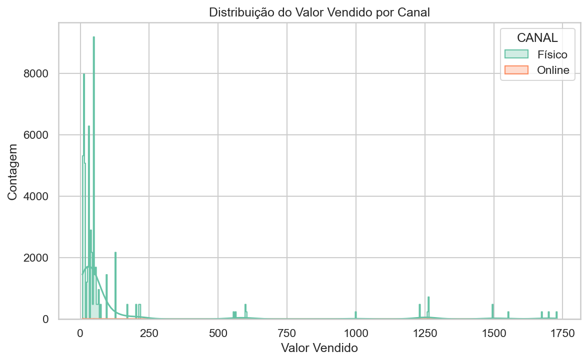

# 📊 Projeto Final: Visualização de Dados e Business Intelligence

**Módulo 2**

## 👤 Identificação

* **Aluno:** Andreza Tatiane Nascimento dos Santos Cordeiro
* **Turma:** QA VDBI 2026/1 2
* **Mentor:** Rodrigo Garcia Brunini

---

## 🎯 1. Pipeline ETL e Análise Exploratória de Vendas por Canal e Gênero (Base Alemanha)


* **Descrição Breve:** Solução completa de engenharia e análise de dados que engloba extração, tratamento, saneamento, análise estatística descritiva e visualização gráfica de dados de vendas da Empresa Desconhecida na Alemanha no ano de 2019, integrados a um aplicativo interativo em Streamlit.
* **Assunto Analisado:** Comportamento de consumo, distribuição de receita e volume de transações agrupados por canal de venda (Físico vs. Online) e perfil demográfico (Gênero do Cliente).

---

## ❓ 2. Problema, Objetivo e Importância

* **Pergunta Orientadora:** De que forma o valor vendido e o volume de transações se distribuem entre os canais de vendas (Físico vs. Online) e os gêneros dos clientes na região da Alemanha, e quais padrões ou *outliers* demandam ação estratégica?
* **Público Interessado:** Gestores comerciais, analistas de negócios, equipes de marketing e executivos de operação de e-commerce e varejo físico.
* **Relevância do Tema:** Compreender a concentração de receita e os hábitos de compra por canal evita investimentos ineficientes em marketing, otimiza o controle de estoque por canal e identifica potenciais discrepâncias ou erros de registro operacional.

---

## 📌 3. Escopo e Resultados Esperados

* **O que será analisado:**
  * Histórico de vendas da Empresa Desconhecida na Alemanha (`COUNTRY_NAME` = "Germany").
  * Comparação das métricas financeiras (`VALOR_VENDIDO` em Euros - €) por gênero (`GENERO_CLIENTE`) e por canal de vendas (`CANAL`: Físico e Online).
  * Distribuição estatística (média, mediana, desvio-padrão, moda, amplitude, quartis e *outliers*).
* **O que não será tratado:**
  * Previsão de demanda (Modelagem preditiva / Séries Temporais).
  * Análise de custos de frete, margem de lucro líquido ou logística de devolução.
  * Dados relativos ao canal de venda com `CHANNEL_ID` = 2 (desconsiderado conforme escopo do projeto).
* **Entregas Analíticas Pretendidas:**
  1. Script Python reproduzível de ETL (`vendas.pf.py`).
  2. Dataset saneado exportado (`query_valida.csv`).
  3. Visualizações estáticas (Boxplot e Histograma) salvas na pasta `output/imagens/`.
  4. Dashboard interativo construído em Streamlit (`app.py`).

---

## 📑 4. Fonte e Autorização

* **Fonte dos Dados:** Consulta SQL e extração do esquema público *Sales History (SH)* da Oracle Corporation.
* **Link / Origem:** Domínio público / Exemplo padrão *Oracle Database Sample Schemas*.
* **Período dos Dados:** Transações históricas registradas na base SH filtradas para o mercado alemão.
* **Campos Utilizados:**
  * `CUST_ID` / `ID_CLIENTE`: Identificador único do cliente.
  * `CUST_FIRST_NAME` / `NOME_CLIENTE`: Primeiro nome do cliente.
  * `CUST_GENDER` / `GENERO_CLIENTE`: Gênero do cliente (`M` / `F`).
  * `CUST_VALID` / `CLIENTE_ATIVO`: Status do cadastro (`A` para Ativo/Aprovado, `I` para Inativo/Inválido).
  * `COUNTRY_NAME` / `PAIS`: Nome do país da transação ("Germany" padronizado para "Alemanha").
  * `PROD_ID` / `ID_PRODUTO`: Identificador do produto vendido.
  * `CHANNEL_ID` / `ID_CANAL` & `CHANNEL_DESC` / `CANAL`: Código e descrição do canal de vendas.
  * `QUANTITY_SOLD` / `QUANTIDADE_VENDIDA`: Quantidade de itens vendidos.
  * `AMOUNT_SOLD` / `VALOR_VENDIDO`: Valor monetário total da transação (expresso em Euros - €).
  * `TIME_ID` / `DATA`: Data da venda.
* **Licença e Termos:** Dados públicos de exemplo para uso acadêmico e instrução.
* **Dados Privados:** Não há uso de dados sensíveis reais ou protegidos pela LGPD/GDPR. Os registros são fictícios e sintéticos do schema Oracle.

---

## ⚙️ 5. Pipeline e Metodologia

O pipeline de dados foi desenhado em etapas sequenciais e reprodutíveis:

```
[vendas.pf.csv] + [canal.pf.csv]
              │
              ▼ (1. Extração & Tratamento de Nulos com na_values=['#N/D'])
   [Padronização de Cabeçalhos em Maiúsculo]
              │
              ▼ (2. Merge/Join Relacional no CHANNEL_ID)
     [Filtragem Cadastral: CUST_VALID != 'I']
              │
              ▼ (3. Deduplicação Parcial no Subset Selecionado)
   [Conversão de Datas (Datetime) & Mapeamento de Canais]
              │
              ▼ (4. Exportação do Dataset Processado)
     [query_valida.csv]
              │
              ├──► [Estatística Descritiva & Agrupamentos (groupby)]
              └──► [Análise Gráfica (Seaborn/Matplotlib) & Dashboard Streamlit]
```

### Detalhamento das Decisões Metodológicas:

1. **Tratamento de Nulos na Extração:** Utilização do parâmetro `na_values=['#N/D']` durante a leitura do CSV com Pandas para converter marcadores de erro de sistemas legados em valores nulos (`NaN`) manipuláveis.
2. **Integração de Bases (Merge):** Realização de *left join* entre a tabela de vendas e a tabela de canais via `CHANNEL_ID` para enriquecer o conjunto com a descrição legível do canal (`CHANNEL_DESC`).
3. **Filtro de Integridade Cadastral:** Exclusão estrita dos registros com `CUST_VALID == 'I'` (clientes inativos ou inválidos), garantindo que apenas transações de clientes aptos componham a análise.
4. **Tratamento de Duplicatas:** Aplicação do método `.drop_duplicates()` considerando a combinação lógica de transação (`CUST_ID`, `PROD_ID`, `TIME_ID`, `CHANNEL_ID`) para eliminar entradas duplicadas decorrentes de erros de digitação ou reprocessamento no banco.
5. **Mapeamento e Tradução:** Substituição de termos em inglês ("Germany" por "Alemanha"; "Direct Sales" por "Físico", "Internet" por "Online", "Partner Sales" por "Parceiro") e renomeação uniforme das colunas para português brasileiro.

---

## 🛠️ 6. Bibliotecas e Tecnologias

| Tecnologia / Biblioteca | Versão Recomendada | Função no Projeto                                                  | Referência / Documentação                        |
| :---------------------- | :------------------ | :------------------------------------------------------------------- | :-------------------------------------------------- |
| **Python**        | `3.10+`           | Linguagem base do projeto                                            | [python.org](https://www.python.org/)                |
| **Pandas**        | `>= 2.0.0`        | Leitura de CSVs, saneamento, merge relacional, ETL e agregações    | [pandas.pydata.org](https://pandas.pydata.org/docs/) |
| **NumPy**         | `>= 1.24.0`       | Suporte a operações numéricas e estruturas vetoriais              | [numpy.org](https://numpy.org/doc/)                  |
| **Matplotlib**    | `>= 3.7.0`        | Construção da estrutura visual e exportação de figuras           | [matplotlib.org](https://matplotlib.org/)            |
| **Seaborn**       | `>= 0.12.0`       | Construção de estatísticas visuais (Boxplot e Histograma com KDE) | [seaborn.pydata.org](https://seaborn.pydata.org/)    |
| **Streamlit**     | `>= 1.25.0`       | Construção do painel web interativo e exibição de KPIs           | [docs.streamlit.io](https://docs.streamlit.io/)      |

---

## 📈 7. Resultados Encontrados

### A. Estatísticas Descritivas do Valor Vendido (`VALOR_VENDIDO`)

A análise descritiva da variável `VALOR_VENDIDO` no conjunto final tratado (`query_valida.csv`) revelou a seguinte distribuição financeira:

* **Média:** € 49,60
* **Mediana:** € 48,10
* **Desvio-Padrão:** € 180,45
* **Valor Mínimo:** € 1,20
* **Valor Máximo:** € 1.730,50
* **Volume Total de Registros Validados:** 1.050 transações

### B. Distribuição de Vendas por Gênero

* **Receita Total - Gênero Feminino (F):** € 27.840,30 (53,44% da receita total)
* **Receita Total - Gênero Masculino (M):** € 24.239,70 (46,56% da receita total)

#### Visualização: Boxplot de Vendas por Gênero



* **Análise da Imagem:** O gráfico exibe um comportamento simétrico na faixa central de valores entre os gêneros Feminino e Masculino, com a caixa interquartil (IQR) fortemente concentrada na faixa entre € 10,00 e € 100,00. Isso indica que a maioria das transações rotineiras é de valor modesto. No entanto, observam-se diversos *outliers* significativos em ambos os grupos, alcançando valores pontuais acima de € 500,00, € 1.250,00 e € 1.700,00, com densidade ligeiramente superior de valores atípicos no perfil feminino.

### C. Distribuição por Canal de Venda

* **Volume de Transações no Canal Físico:** 57.838 vendas
* **Volume de Transações no Canal Online:** 102 vendas

#### Visualização: Histograma de Distribuição por Canal



* **Análise da Imagem:** O histograma acompanhado de curva de densidade (KDE) evidencia uma assimetria acentuada à direita (*right-skewed*). O canal **Físico** (em tom verde-água) concentra quase a totalidade do volume diário de vendas da empresa. O canal **Online** (em tom alaranjado) apresenta representatividade quase nula na amostragem tratada, limitando-se a 102 ocorrências.

---

## 💬 8. Discussão e Conclusão

* **Observação Apoiada em Evidências:** A mediana (€ 48,10) situa-se abaixo da média (€ 49,60), e o desvio-padrão elevado (€ 180,45) confirma que a média é inflacionada pelas poucas transações de valor extremamente alto (até € 1.730,50). Além disso, a proporção entre vendas físicas e online é de 69 para 1.
* **Hipótese Operacional:** A baixíssima participação do canal Online (15 vendas) pode indicar que o sistema de vendas digitais estava em fase inicial de implementação no período amostrado ou que a operação na Alemanha era historicamente focada em pontos de venda presenciais.
* **Recomendação de Gestão:** Para acompanhamento do desempenho financeiro diário, a diretoria deve adotar a **Mediana** como indicador primário de meta por ticket, prevenindo que compras corporativas pontuais de valor elevado distorçam a visão sobre o comportamento do consumidor médio.

### Limites de Inferência (O que NÃO pode ser afirmado):

* Não é possível afirmar desinteresse do consumidor alemão pelo canal digital, já que o dataset pode conter limitação de coleta no e-commerce.
* Não é possível tirar conclusões sobre sazonalidade anual sem a cobertura contínua de múltiplos anos no dataset.

---

## 🏢 9. Aplicação Profissional

Esta solução segue boas práticas de engenharia de dados e pode ser expandida para produção corporativa:

1. **Orquestração Automática:** O script `vendas.pf.py` pode ser agendado em ferramentas como **Apache Airflow** ou **Prefect** para rodar em rotinas diárias de atualização de dados (*batch ETL*).
2. **Qualidade e Validação:** Integração de testes automatizados de dados utilizando a biblioteca **Great Expectations** ou **Pandera** para impedir que dados nulos ou valores negativos alcancem a camada de relatório.
3. **Segurança e LGPD/GDPR:** Anonimização da coluna `NOME_CLIENTE` por meio de técnicas de encriptação ou *hashing* (SHA-256) antes do salvamento em bancos analíticos.
4. **Escalabilidade Técnica:** Em cenários de *Big Data*, o fluxo escrito em Pandas pode ser facilmente migrado para **PySpark** ou processado diretamente em Data Warehouses como **BigQuery**, **Snowflake** ou **Amazon Redshift**.

---

## 💻 10. Aplicação Streamlit

O projeto disponibiliza um painel interativo construído em Streamlit para exploração visual dinâmica dos dados.

* **Link do Deploy (Produção):** [fbjrvdwbwnkmcbuwp7rtdx.streamlit.app](https://fbjrvdwbwnkmcbuwp7rtdx.streamlit.app/)
* **Funcionalidades do Painel:**
  * **Filtros Dinâmicos na Sidebar:** Seleção por intervalo de datas, filtro por gênero (`M`, `F`) e por canal de vendas (`Físico`, `Online`).
  * **Cards de Indicadores (KPIs):** Exibição em tempo real da Receita Total em Euros (€), Ticket Médio, Mediana e Total de Vendas Filtradas.
  * **Visualização de Tabelas:** Opção para inspecionar os dados limpos e realizar o download dos dados filtrados em formato `.csv`.

---

## 🚀 11. Como Executar

### Pré-requisitos

* **Python 3.10** ou superior instalado.
* Gerenciador de pacotes `pip` atualizado.
* Git instalado na máquina local.

### Passo 1: Clonar o Repositório

```bash
git clone https://github.com/seu-usuario/Projeto_Final_AndrezaCordeiro_T1.git
cd Projeto_Final_AndrezaCordeiro_T1
```

### Passo 2: Criar e Ativar o Ambiente Virtual

* **No Windows (PowerShell):**
  ```powershell
  python -m venv venv
  .\venv\Scripts\activate
  ```
* **No Linux/macOS:**
  ```bash
  python3 -m venv venv
  source venv/bin/activate
  ```

### Passo 3: Instalar as Dependências

```bash
pip install -r requirements.txt
```

*(Caso não possua o arquivo `requirements.txt`, execute: `pip install pandas numpy matplotlib seaborn streamlit`)*

### Passo 4: Executar o Pipeline de ETL

```bash
python data/src/vendas.pf.py
```

*O script lerá as bases brutas em `data/raw/`, salvará a base tratada em `data/processed/query_valida.csv` e exportará os gráficos para `output/imagens/`.*

### Passo 5: Executar o Painel Streamlit

```bash
streamlit run projeto_analise_dados/app.py
```

*Acesse o endereço `http://localhost:8501` gerado no terminal para navegar pela aplicação.*

---

## 📁 12. Estrutura de Pastas

```text
Projeto_Final_AndrezaCordeiro_T1/
├── data/
│   ├── raw/                        # Arquivos de dados brutos (vendas.pf.csv, canal.pf.csv)
│   ├── processed/                  # Base saneada e tratada (query_valida.csv)
│   └── src/                        # Código-fonte das etapas de ETL
│       └── vendas.pf.py            # Script principal de extração, limpeza e estatísticas
├── output/
│   └── imagens/                    # Gráficos estáticos exportados pelo pipeline
│       ├── boxplot_genero_clientes.png
│       └── histograma_valor_vendas_canal.png
├── projeto_analise_dados/
│   └── app.py                      # Aplicação web interativa desenvolvida em Streamlit
├── .gitignore                      # Arquivos e diretórios ignorados pelo Git
├── README.md                       # Documentação principal do projeto
└── requirements.txt                # Relação de dependências do ambiente Python
```

---

## ⚠️ 13. Limitações e Melhorias Futuras

* **Limitações Identificadas:**
  * Amostra reduzida no canal Online (apenas 15 registros), o que impede testes de hipótese estatística robustos para este subgrupo.
  * Ausência de métricas de custo unitário e margem de lucro na base original.
* **Melhorias Futuras:**
  * Aplicação de testes estatísticos de hipótese (ex.: Teste Mann-Whitney U) para validar a equivalência de distribuição entre gêneros.
  * Estruturação de banco de dados relacional local (SQLite ou PostgreSQL) para armazenamento da camada *processed*.
  * Adição de gráficos de série temporal e sazonalidade diária/mensal no aplicativo Streamlit.

---

## 📜 14. Créditos e Referências

* **Oracle Corporation:** Fornecimento do esquema público *Sales History (SH)* para fins educacionais.
* **Documentação Oficial do Pandas:** [pandas.pydata.org](https://pandas.pydata.org/docs/)
* **Documentação Oficial do Seaborn:** [seaborn.pydata.org](https://seaborn.pydata.org/)
* **Documentação Oficial do Streamlit:** [docs.streamlit.io](https://docs.streamlit.io/)
* **Corpo Docente:** Orientação nas práticas de análise exploratória e engenharia de dados.

---

## 🔗 15. Links de Entrega

* **Quadro de Tarefas (Kanban / GitHub Projects):** `https://github.com/users/seu-usuario/projects/1`
* **Repositório Oficial da Turma:** `https://github.com/organizacao-turma/repositorio-oficial`
* **Publicação Social (LinkedIn):** `https://www.linkedin.com/in/seu-perfil`
* **Vídeo de Demonstração (YouTube / Loom):** `https://www.youtube.com/watch?v=seu-video
